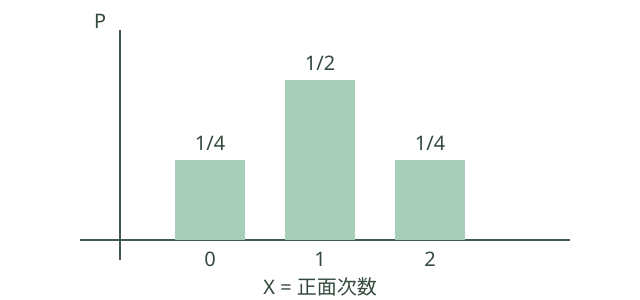

# 概率论与数理统计：知识点、公式与定理

> 用途：系统学习大学概率统计，衔接考研与机器学习。  
> 范围：概率基础、随机变量、极限定理、统计推断与回归；补充贝叶斯、信息量与实验意识。不是特定年度考试大纲。  
> 配套：[学习计划](math-study-schedule.md) · [高等数学](advanced-mathematics-knowledge.md) · [线性代数](linear-algebra-knowledge.md)

## 1. 概率与统计分别做什么？

- **概率：已知模型推结果。** 已知硬币正面概率 p，研究抛100次出现多少正面。
- **统计：已知数据推模型。** 已经看到100次抛掷结果，估计 p，并量化不确定性。
- 描述统计整理已有数据；统计推断在抽样假设下对总体作判断。

建议顺序：事件概率 → 一维随机变量 → 多维分布 → 数字特征 → 极限定理 → 抽样分布 → 参数估计 → 假设检验 → 回归与贝叶斯。

先修：集合、计数、函数、导数与积分；多维概率用到重积分，协方差矩阵与回归用到线性代数。

## 2. 随机事件与概率公理【基础】

### 初学者先理解什么？

**随机试验**是条件明确但结果事先不确定的过程；**样本空间**列出所有可能结果，**事件**是其中的一个子集。

例如掷公平六面骰，样本空间为 \(\{1,2,3,4,5,6\}\)，偶数事件为 \(\{2,4,6\}\)，概率为 \(3/6=1/2\)。按结果数量相除要求有限且等可能。

样本空间 Ω 是所有可能结果的集合；事件是可赋予概率的结果集合。严格理论需要事件族（σ代数），初学有限模型可直接从子集理解。

概率满足：非负性、P(Ω)=1、可列可加性（可数个两两互斥事件的并，其概率等于各概率之和）。

\[
P(A^c)=1-P(A),\quad P(A\cup B)=P(A)+P(B)-P(A\cap B).
\]

- A⊆B ⇒ P(A)≤P(B)。
- 并集上界：P(∪A_i)≤ΣP(A_i)。
- 有限且各结果等可能时，概率=有利结果数/全部结果数；不等可能时不能按个数相除。
- 概率0不一定表示事件绝不可能出现，例如连续均匀模型下某一个点的概率为0。

**从公理核验事件公式。** \(A\) 与 \(A^c\) 不交且并为 \(\Omega\)，故 \(P(A)+P(A^c)=1\)。把 \(B\) 分成互斥的 \(B\setminus A\) 与 \(A\cap B\)，又 \(A\cup B\) 是 \(A\) 与 \(B\setminus A\) 的不交并，因此 \(P(A\cup B)=P(A)+P(B)-P(A\cap B)\)。若 \(A\subseteq B\)，则 \(B=A\cup(B\setminus A)\)，由非负性得 \(P(A)\le P(B)\)。对可数事件，令 \(D_1=A_1\)、\(D_i=A_i\setminus\bigcup_{j<i}A_j\)，各 \(D_i\) 不交且并集相同；由 \(D_i\subseteq A_i\) 和可列可加性得 \(P(\bigcup_iA_i)=\sum_iP(D_i)\le\sum_iP(A_i)\)。

**概率对单调事件列的连续性。** 若 \(A_1\subseteq A_2\subseteq\cdots\)，令 \(D_1=A_1,D_n=A_n\setminus A_{n-1}\)。这些事件两两互斥，且 \(A_n=\bigcup_{j\le n}D_j\)、\(\bigcup_n A_n=\bigcup_jD_j\)。可列可加性给出 \(P(\bigcup_n A_n)=\sum_jP(D_j)=\lim_nP(A_n)\)。若 \(A_n\) 递减，则其补集递增；对补集应用刚才的结论，再用补事件公式得到 \(P(\bigcap_nA_n)=\lim_nP(A_n)\)。概率空间总质量为 1，故这里不存在无穷测度下递减连续性所需的额外有限性问题。

## 3. 条件概率、独立与贝叶斯【核心】

### 初学者先理解什么？

**条件概率**是在已知某事件发生的条件下计算另一个事件的概率；分母是已知条件事件的概率，必须大于 0。**独立**表示交集概率等于各自概率之积。

例如公平骰子已知是偶数后，大于 4 只有点数 6，故概率为 \(1/3\)。**贝叶斯公式**把“已知原因求结果”与“已知结果反推原因”联系起来，但两种条件概率不能直接交换。

**跟着算一遍：反推故障概率。** 某设备故障率为 1%，有故障时报警概率为 90%，无故障时误报概率为 5%。取 10000 次同分布的想象情形：约 100 次故障中有 90 次报警；约 9900 次无故障中有 495 次报警。因此已知报警时，故障的模型概率为 \(90/(90+495)=2/13\approx15.4\%\)。分子与分母都表示“报警”这一共同条件下的数量；结果依赖题目给定的故障率及报警概率。

\[
P(A\mid B)=\frac{P(A\cap B)}{P(B)},\qquad P(B)>0.
\]

乘法公式：P(A∩B)=P(A|B)P(B)，可按链式规则推广到多个事件。

- 独立：P(A∩B)=P(A)P(B)。正概率下等价于知道 B 不改变 A 的概率。
- 互斥：A∩B=∅。两个正概率互斥事件不独立。
- 多事件两两独立不保证相互独立；相互独立要求所有有限子组的交事件概率都分解。

若 B_i 构成有限或可数划分，且相关条件概率有定义：

\[
P(A)=\sum_i P(A\mid B_i)P(B_i),
\]
\[
P(B_j\mid A)=\frac{P(A\mid B_j)P(B_j)}{\sum_iP(A\mid B_i)P(B_i)},\qquad P(A)>0.
\]

**例：** 某故障率1%，检测灵敏度90%、误报率5%。检测阳性后确实故障的概率为

\[
\frac{0.9\times0.01}{0.9\times0.01+0.05\times0.99}\approx15.4\%.
\]

这说明 P(阳性|故障) 与 P(故障|阳性) 不同，基础发生率不能忽略。

### 实际问题：检测呈阳性，究竟多可能有故障？

假设故障率为 1%，故障时阳性率 90%，正常时误报率 5%。在 10000 个对象中，按期望频数约有 100 个故障，其中 90 个阳性；9900 个正常，其中 495 个误报。因此阳性总数约 585，阳性者确有故障的比例约 \(90/585=15.4\%\)。这是按模型计算，不是对每一组实际观测数量的保证。

### 全概率与贝叶斯公式的推导

设故障事件为 \(B\)，阳性事件为 \(A\)。\(B\) 与 \(B^c\) 把样本空间分成互斥部分，所以

\[
P(A)=P(A\cap B)+P(A\cap B^c)
=P(A\mid B)P(B)+P(A\mid B^c)P(B^c).
\]

由条件概率定义，\(P(B\mid A)=P(A\cap B)/P(A)\)。将乘法公式与上式代入，得到

\[
P(B\mid A)=\frac{P(A\mid B)P(B)}{P(A\mid B)P(B)+P(A\mid B^c)P(B^c)}.
\]

条件概率的分母需大于零。方法的作用是把检测结果与原始故障率结合，避免把“故障时阳性概率”误认成“阳性时故障概率”。

**多事件独立性的反例。** 两次公平独立抛硬币，以四个等可能结果 HH、HT、TH、TT 为样本空间。令 \(A=\{HH,HT\}\)、\(B=\{HH,TH\}\)、\(C=\{HH,TT\}\)。三个事件概率均为 \(1/2\)，任意两个的交集均为 \(\{HH\}\)、概率 \(1/4\)，所以两两独立；但三者交集仍为 \(\{HH\}\)，其概率 \(1/4\ne(1/2)^3\)，故不相互独立。这个例子说明检查两两交集不够。

## 4. 随机变量与分布【核心】

### 初学者先理解什么？

**随机变量**给每个试验结果分配一个数；**分布**说明这些数以什么概率出现。离散变量可列出各取值及概率；连续变量通常用密度描述区间概率。

公平硬币独立抛两次，正面次数 \(X\) 取 0、1、2 的概率分别是 1/4、1/2、1/4，总和为 1。不同的样本结果可以对应同一个随机变量值。

随机变量将结果映射为实数。分布函数：

\[
F_X(x)=P(X\leq x).
\]

F 单调不减、右连续，x→−∞ 时趋于0、x→∞ 时趋于1。

- 当 a≤b 时，P(a<X≤b)=F(b)−F(a)。
- 离散型：概率质量函数 p(x)≥0，Σp(x)=1。
- 连续型（此处指绝对连续分布）：存在密度 f≥0，∫f=1，F(x)=∫[−∞到x]f(t)dt。
- 连续密度值可以>1；区间积分才是概率，P(X=x)=0。
- 并非所有分布都只有“纯离散”或“有密度连续”两种；也有混合分布等。

**分布函数公式的核验。** 当 \(a<b\)，事件 \(\{X\le b\}\) 是 \(\{X\le a\}\) 与 \(\{a<X\le b\}\) 的不交并，因此区间概率为 \(F(b)-F(a)\)。若 \(X\) 有密度，区间概率定义为密度积分，而单点集合的积分为零，所以 \(P(X=x)=0\)。分布函数单调性来自事件包含关系；右连续性来自概率对递减事件序列的连续性。

**分布函数端点与右连续的证明。** 对任意递减到 x 的实数列 \(x_n\downarrow x\)，事件 \(\{X\le x_n\}\) 递减到 \(\{X\le x\}\)，由概率递减连续性得 \(F(x_n)\to F(x)\)，这给出右连续。若 X 几乎处处取有限实数，则 \(\{X\le n\}\uparrow\Omega\)（至多差一个零概率事件），故 \(F(n)\to1\)；\(\{X\le-n\}\downarrow\varnothing\) 几乎处处，故 \(F(-n)\to0\)。单调性再把整数列极限扩展到连续自变量趋于正、负无穷的极限。若允许 X 以正概率取 \(\pm\infty\)，这两个端点结论需要相应修改。

### 随机变量、条件概率与常见分布

条件概率 \(P(A|B)=P(A\cap B)/P(B)\) 的分母是已经发生的条件事件 \(B\)，要求 \(P(B)>0\)。将样本空间限制到 \(B\) 后重新归一化，便得到该式。若有限或可数个 \(B_i\) 两两互斥且并成全集、各 \(P(B_i)>0\)，则全概率公式 \(P(A)=\sum_iP(A|B_i)P(B_i)\)；若另有 \(P(A)>0\)，贝叶斯公式反向更新原因概率 \(P(B_j|A)=P(A|B_j)P(B_j)/P(A)\)。医疗检测的阳性预测、质量缺陷追因可用此模型，但须使用真实基准率和检测准确率。

离散随机变量分布列列出取值与概率；若 \(\sum|x_i|p_i<\infty\)，均值 \(E(X)=\sum x_ip_i\)；若二阶矩有限，方差 \(D(X)=\sum(x_i-E(X))^2p_i\)。在独立同分布且均值有限的重复抽样中，样本平均依大数定律接近均值；方差衡量波动大小。若 \(X\sim B(n,p)\)，则 \(P(X=k)=C_n^kp^k(1-p)^{n-k}\)，\(E(X)=np\)，\(D(X)=np(1-p)\)；前提为固定次数、相互独立、每次成功概率相同。超几何分布用于有限总体不放回抽样，\(P(X=k)=C_M^kC_{N-M}^{n-k}/C_N^n\)。两种抽样模型的常见区别是不放回时后续成功概率通常改变。

正态分布 \(N(\mu,\sigma^2)\) 以均值定位、以标准差描述散布，数据常近似钟形但并非所有数据都正态。成对数据用散点图观察相关方向和强弱，样本相关系数刻画线性关联；相关不等于因果。线性回归 \(\hat y=a+bx\) 用最小二乘使残差平方和最小。分类变量用列联表，独立性检验比较观察频数与独立假设下期望频数；结论受样本量、抽样设计和检验近似条件约束。

## 5. 常见离散分布【核心】

### 初学者先理解什么？

**离散分布**将概率分配给可数的取值。伯努利分布描述一次成功或失败；二项分布描述固定次数、相互独立且成功概率相同的试验中的成功次数。

例如公平硬币独立抛 3 次，正面次数 \(X\sim B(3,1/2)\)，恰好 2 次正面的概率是 \(\binom32(1/2)^3=3/8\)。不放回抽样通常不满足各次独立条件。

| 分布 | 概率质量函数 | 均值 | 方差 | 典型模型 |
|---|---|---|---|---|
| Bernoulli(p) | P(X=1)=p，P(X=0)=1−p | p | p(1−p) | 一次成败 |
| Binomial(n,p) | P(X=k)=C_n^k p^k(1−p)^(n−k) | np | np(1−p) | n次独立同概率成败 |
| Poisson(λ) | P(X=k)=e^(−λ)λ^k/k!，k≥0 | λ | λ | 单位区间事件数模型 |
| Geometric(p) | P(X=k)=(1−p)^(k−1)p，k≥1 | 1/p | (1−p)/p² | 首次成功所需次数 |
| Hypergeometric(N,M,n) | C_M^k C_(N−M)^(n−k)/C_N^n | nM/N | n(M/N)(1−M/N)(N−n)/(N−1) | 不放回抽样 |

条件：n、N、M 为合适整数，0≤p≤1；几何分布 p>0；泊松 λ>0；超几何 N>1 时使用表中方差，k 需同时满足可取的计数范围。退化端点单独理解。

- 几何分布也有“成功前失败次数”版本，取值从0开始，均值变为(1−p)/p，必须先确认定义。
- n大、p小、np≈λ 时二项分布可用泊松近似，这是近似而非恒等。
- 不放回抽样一般不独立，不能直接当成二项分布。

### 离散分布表的逐项推导

1. **伯努利：** \(P(X=1)=p,P(X=0)=1-p\)，所以 \(E(X)=p\)，且 \(E(X^2)=p\)，方差为 \(p-p^2=p(1-p)\)，适用于 \(0\le p\le1\)。
2. **二项：** 把成功次数写为 \(X=I_1+\cdots+I_n\)，各指示变量独立且均服从伯努利分布。故 \(EX=np\)、\(\operatorname{Var}(X)=np(1-p)\)。恰有 \(k\) 次成功需要选择 \(k\) 个成功位置，每条路径概率为 \(p^k(1-p)^{n-k}\)，乘以 \(\binom nk\) 得概率质量函数。\(n\) 为非负整数、\(0\le p\le1\)，端点 \(p=0,1\) 按退化分布理解。
3. **泊松：** 对 \(k\ge0\)，\(P(X=k)=e^{-\lambda}\lambda^k/k!\)，由指数级数其和为 1。对 \(k\ge1\) 利用 \(kp_k=\lambda p_{k-1}\)，求和得 \(EX=\lambda\)；对 \(k\ge2\)，\(k(k-1)p_k=\lambda^2p_{k-2}\)，故 \(E[X(X-1)]=\lambda^2\)，进而 \(EX^2=\lambda^2+\lambda\)、\(\operatorname{Var}(X)=\lambda\)。这里 \(\lambda>0\)。
4. **几何：** 若各次独立、成功概率 \(p\in(0,1]\)，第一次成功在第 \(k\) 次要求前 \(k-1\) 次失败且第 \(k\) 次成功，概率为 \((1-p)^{k-1}p\)。令 \(q=1-p<1\)，利用几何级数及其在 \(|q|<1\) 内的逐项求导，\(\sum_{k\ge1}kq^{k-1}=1/(1-q)^2\)，得到 \(EX=1/p\)；再用二阶导数得 \(E[X(X-1)]=2q/p^2\)，故 \(\operatorname{Var}(X)=q/p^2\)。
5. **超几何：** \(N\) 件中 \(M\) 件目标，不放回等可能抽 \(n\) 件，恰有 \(k\) 件目标的无序样本数为 \(\binom Mk\binom{N-M}{n-k}\)，除以全部 \(\binom Nn\) 得表中质量函数。令 \(p=M/N\)，将目标件数写成 \(n\) 个抽取指示变量之和，可得均值 \(np\)。\(N>1\)、\(i\ne j\) 时，两次都抽中目标的概率为 \(E(I_iI_j)=M(M-1)/[N(N-1)]\)，减去 \(E(I_i)E(I_j)=p^2\) 得 \(\operatorname{Cov}(I_i,I_j)=-p(1-p)/(N-1)\)。于是方差为 \(np(1-p)+n(n-1)[-p(1-p)/(N-1)]=np(1-p)(N-n)/(N-1)\)。要求 \(0\le M,n\le N\)、各量为整数，且 \(\max(0,n-(N-M))\le k\le\min(n,M)\)；\(N=1\) 时按退化分布直接计算。

**二项分布的泊松近似推导。** 设 \(X_n\sim\operatorname{Binomial}(n,p_n)\)，\(np_n\to\lambda>0\)。对固定非负整数 k，
\[
P(X_n=k)=\frac{n(n-1)\cdots(n-k+1)}{n^kk!}
(np_n)^k(1-p_n)^n(1-p_n)^{-k}.
\]
第一因子趋于 \(1/k!\)，第二因子趋于 \(\lambda^k\)，且 \(p_n\to0\)。由 \(\log(1-p_n)/p_n\to-1\)，得 \(n\log(1-p_n)\to-\lambda\)，因此 \((1-p_n)^n\to e^{-\lambda}\)，最后一因子趋于 1。故对每个固定 k，概率趋于 \(e^{-\lambda}\lambda^k/k!\)，即相应泊松概率。这里是 n 趋于无穷的极限；有限 n 的近似误差依赖具体参数，不能由“n 大、p 小”单独确定一个统一精度。

## 6. 常见连续分布【核心】

### 初学者先理解什么？

**概率密度**是描述连续分布的函数，区间概率是对应区间下的面积；密度值本身一般不是单点概率。对连续随机变量，单个点的概率为 0。

例如 \(X\sim U(0,2)\) 时密度在区间内为 1/2，\(P(0<X<1)=1/2\)。正态分布的均值给出中心，正标准差控制分散程度；概率由区间面积决定。

### 6.1 均匀分布 U(a,b)

\[
f(x)=\frac1{b-a},\quad a<x<b;\qquad E(X)=\frac{a+b}2,\quad Var(X)=\frac{(b-a)^2}{12}.
\]

a<b，区间外密度为0。

### 6.2 指数分布 Exp(λ)

\[
f(x)=\lambda e^{-\lambda x},\ x\geq0;\qquad E(X)=1/\lambda,\quad Var(X)=1/\lambda^2.
\]

λ>0，此处采用速率参数；区间外密度为0。无记忆性：P(X>s+t|X>s)=P(X>t)，s、t≥0。

### 6.3 正态分布 N(μ,σ²)

\[
f(x)=\frac1{\sqrt{2\pi}\sigma}\exp\left[-\frac{(x-\mu)^2}{2\sigma^2}\right],\quad\sigma>0.
\]

E(X)=μ，Var(X)=σ²；标准化 Z=(X−μ)/σ∼N(0,1)。若 Φ 为标准正态分布函数，

\[
P(a<X\leq b)=\Phi((b-\mu)/\sigma)-\Phi((a-\mu)/\sigma),\qquad a\le b.
\]

正态随机变量的线性组合在联合正态条件下仍正态（允许退化情形）；这是联合正态的线性组合定义。只有边缘分别正态，不能自动推定其和正态：取 \(X\sim N(0,1)\)，独立地取等概率符号 \(S=\pm1\)，令 \(Y=SX\)。由标准正态的对称性，Y 的边缘仍为标准正态；但 \(X+Y\) 以概率 1/2 等于 0、以概率 1/2 等于 2X，既不是非退化正态也不是单点退化分布。

### 连续分布公式的逐项推导

1. **均匀分布：** \(a<b\) 时，密度积分 \(\int_a^b1/(b-a)\,dx=1\)。直接积分得 \(EX=\int_a^b x/(b-a)\,dx=(a+b)/2\)，以及 \(EX^2=(a^2+ab+b^2)/3\)。代入 \(EX^2-(EX)^2\)，得到 \((b-a)^2/12\)；区间端点的密度取值不改变积分概率。
2. **指数分布：** 速率 \(\lambda>0\)，\(\int_0^\infty\lambda e^{-\lambda x}dx=1\)，尾概率 \(P(X>t)=e^{-\lambda t}\;(t\ge0)\)。分部积分得 \(EX=1/\lambda\)、\(EX^2=2/\lambda^2\)，所以方差是 \(1/\lambda^2\)。对 \(s,t\ge0\)，\(P(X>s+t\mid X>s)=e^{-\lambda(s+t)}/e^{-\lambda s}=e^{-\lambda t}=P(X>t)\)，分母为正，得到无记忆性。
3. **正态分布：** 标准高斯积分 \(\int_{-\infty}^{\infty}e^{-z^2/2}dz=\sqrt{2\pi}\)：将其平方写为平面上的二重积分，改用极坐标得 \(2\pi\int_0^\infty e^{-r^2/2}r\,dr=2\pi\)。因此除以 \(\sqrt{2\pi}\) 后密度积分为 1。标准密度关于零对称，故 \(EZ=0\)；分部积分得到 \(EZ^2=1\)。令 \(X=\mu+\sigma Z\;(\sigma>0)\)，则 \(EX=\mu\)、\(\operatorname{Var}(X)=\sigma^2\)，并由一维换元得到表中密度及 \(Z=(X-\mu)/\sigma\)。区间概率再按分布函数相减得到；这依赖非负函数积分和极坐标换元的相应定理。

### 正态分布、相关和回归模型

正态曲线以 \(\mu\) 为中心、\(\sigma\) 控制宽窄；标准化 \(Z=(X-\mu)/\sigma\) 将变量转成标准正态刻度。约 68%、95%、99.7% 分别落在均值左右 1、2、3 个标准差内是经验近似，适用于正态模型而非任意数据。相关系数在 −1 到 1 之间，只度量线性关联；非线性关系可能相关系数接近零，离群点也会显著改变它。

简单线性回归以残差平方和最小确定直线。令 \(\hat y=a+bx\)，对 \(\sum_i(y_i-a-bx_i)^2\) 分别对 \(a,b\) 求最小，得到
\[
b=\frac{\sum_i(x_i-\bar x)(y_i-\bar y)}{\sum_i(x_i-\bar x)^2},\qquad a=\bar y-b\bar x.
\]
上式要求 \(\sum_i(x_i-\bar x)^2>0\)，即横坐标不全相同；否则分母为零，斜率不能按此公式确定。斜率是样本范围内的线性趋势，外推到观测范围外风险大。相关和回归不能单独证明因果，因果判断还需实验设计或控制混杂因素。

**简单线性回归公式的完整推导。** 对固定数据 \((x_i,y_i)\)，记 \(Q(a,b)=\sum_i(y_i-a-bx_i)^2\)，设样本数 n≥1。对 a 求导得 \(\partial Q/\partial a=-2\sum_i(y_i-a-bx_i)\)，因此固定 b 时的最小点满足 \(a=\bar y-b\bar x\)。代回，令 \(X_i=x_i-\bar x,Y_i=y_i-\bar y\)，得
\[
Q(\bar y-b\bar x,b)=\sum_i(Y_i-bX_i)^2
=\sum_iY_i^2-2b\sum_iX_iY_i+b^2\sum_iX_i^2.
\]
若 \(S_{xx}=\sum_iX_i^2>0\)，配方可得 \(Q=\sum_iY_i^2-S_{xy}^2/S_{xx}+S_{xx}(b-S_{xy}/S_{xx})^2\)，其中 \(S_{xy}=\sum_iX_iY_i\)。因此唯一最优斜率为 \(S_{xy}/S_{xx}\)，截距为 \(\bar y-b\bar x\)；这也证明驻点是全局最小值。若 \(S_{xx}=0\)，所有 \(x_i=\bar x\)，拟合值只有一个共同数，最优共同拟合值为 \(\bar y\)，但所有满足 \(a+b\bar x=\bar y\) 的参数对均达到最小，故斜率不唯一。这里证明的是给定样本上的代数最小二乘结论，不依赖误差正态或因果假设。

列联表记录两个分类变量的联合频数。在独立假设下，以样本行、列比例估计后，单元格拟合期望频数为“行总数×列总数÷总数”；真实期望频数依赖总体行、列概率。卡方统计量衡量观察和拟合期望的总体差异。独立性检验结论是对模型和样本证据的判断，需要查看期望频数条件及显著性水平；不能把“未拒绝独立”表述为“已证明独立”。

## 7. 随机变量函数的分布【核心】

### 初学者先理解什么？

已知 \(X\) 的分布后，常需要求 \(Y=g(X)\) 的分布。离散情形可逐一映射并合并相同结果；连续情形可先求分布函数，再在适当条件下求密度。

例如公平骰子点数为 \(X\)，令 \(Y=X\bmod2\)，则 \(Y\) 只取 0、1，各概率均为 1/2。一个输出可能由多个输入得到，不能遗漏对应的概率。

- 分布函数法：先求 P(g(X)≤y)，适用范围广，尤其适合非单调变换。
- 单调变换：X 有密度 f_X，Y=g(X)，g 连续可微且严格单调，逆变换在相应范围可微时，f_Y(y)=f_X(g⁻¹(y))·|(g⁻¹)′(y)|；密度等式按几乎处处理解。
- 非单调变换要分支求和或先求分布函数，不能只取一个逆分支。
- 多元变换使用逆变换雅可比绝对值，需检查支持区域与一一对应条件。

例：X∼U(0,1)，Y=X²，则0<y<1时 F_Y(y)=√y，f_Y(y)=1/(2√y)。

**变换公式的核验。** 若 \(g\) 连续严格递增，令 \(x=g^{-1}(y)\)，则 \(F_Y(y)=P(g(X)\le y)=F_X(g^{-1}(y))\)。在 \(F_X\) 可导且逆函数可导的点，对 \(y\) 求导得到 \(f_Y(y)=f_X(g^{-1}(y))(g^{-1})'(y)\)。若 \(g\) 严格递减，则对应上尾概率，求导多出负号；合并两种情况即取逆导数绝对值。只在 \(Y\) 的支持范围内使用，并按具体定理理解密度等式几乎处处成立。例如 \(Y=X^2,X\sim U(0,1)\)，对 \(0<y<1\)，\(F_Y(y)=P(X\le\sqrt y)=\sqrt y\)，求导得到 \(1/(2\sqrt y)\)。

## 8. 多维分布与独立性【核心】

### 初学者先理解什么？

**联合分布**描述两个或更多随机变量同时取值的规律；**边缘分布**将其他变量求和或积分消去。独立要求联合概率或密度按相应条件分解为边缘的乘积。

例如两次独立抛公平硬币，第一次正面和第二次正面同时发生的概率是 \(1/2\times1/2=1/4\)。知道各自概率仍不足以判断独立，还需要联合关系。

联合分布函数 F(x,y)=P(X≤x,Y≤y)。离散联合概率求和得到边缘；联合密度积分得到边缘：

\[
f_X(x)=\int_{-\infty}^{\infty}f_{X,Y}(x,y)dy.
\]

条件密度：

\[
f_{Y\mid X}(y\mid x)=\frac{f_{X,Y}(x,y)}{f_X(x)},\qquad f_X(x)>0\quad\text{（几乎处处）}.
\]

这是条件密度的构造，不是把 P(X=x)=0 直接放入事件条件概率的分母。

- 独立：联合分布函数分解为边缘分布函数之积；离散概率或联合密度有对应的分解判据（密度按几乎处处理解）。
- 若 X、Y 独立，则分别作用于各自变量的可测函数 g(X)、h(Y) 仍独立：对任意 Borel 集 A、B，事件 \(\{g(X)\in A\}=\{X\in g^{-1}(A)\}\)、\(\{h(Y)\in B\}=\{Y\in h^{-1}(B)\}\)，可测性和原变量独立性使其交事件概率分解。不相关不等于独立，反例见下文。
- 独立连续变量之和的密度（卷积）：f_(X+Y)(z)=∫f_X(x)f_Y(z−x)dx。

**卷积的核验。** 独立且有密度时联合密度为 \(f_X(x)f_Y(y)\)。令 \(Z=X+Y\)，则 \(F_Z(z)=\int f_X(x)[\int_{-\infty}^{z-x}f_Y(y)dy]dx\)。在允许交换求导与积分的条件下，对 \(z\) 求导得到 \(f_Z(z)=\int f_X(x)f_Y(z-x)dx\)；更一般的密度表述在几乎处处意义下成立。若两变量不独立，则应使用联合密度，不能直接相乘。

**多元变换和卷积的一般密度证明。** 设随机向量 U 有密度 \(f_U\)，\(T:D\to E\) 是开集之间的 \(C^1\) 一一对应，逆也 \(C^1\)，且 U 几乎必然落在 D 中。对 E 内任意可测集合 B，令 \(V=T(U)\)，多元换元定理给出
\[
P(V\in B)=\int_{T^{-1}(B)}f_U(u)du
=\int_B f_U(T^{-1}(v))\,|\det DT^{-1}(v)|dv.
\]
因此右侧被积函数是 V 的密度，等式按几乎处处理解。若只在有限个互不重叠的可逆分支上成立，则分别换元后将各分支密度相加；边界或奇异集合须单独检查是否承载概率。

对两个独立且有密度的变量，作变换 \((X,Y)\mapsto(X,Z)=(X,X+Y)\)，逆为 \((x,z)\mapsto(x,z-x)\)，逆雅可比绝对值为 1。因此 \(f_{X,Z}(x,z)=f_X(x)f_Y(z-x)\) 几乎处处成立，积分掉 x 得卷积公式。由于被积函数非负，可以用 Tonelli 定理交换积分；这一路证明不需要逐点对分布函数求导，也不需要密度连续。变换公式本身依赖多元积分换元定理。

## 9. 期望、方差、协方差【核心】

### 初学者先理解什么？

**期望**是概率加权的平均，**方差**衡量相对期望的平方偏离；**协方差**描述两个变量相对各自均值共同变化的方向。

若 \(X\) 以相同概率取 0 和 2，则 \(E(X)=1\)、\(\operatorname{Var}(X)=1\)。对常数 \(a,b\)，\(E(aX+b)=aE(X)+b\)，\(\operatorname{Var}(aX+b)=a^2\operatorname{Var}(X)\)。

\[
E[g(X)]=\sum_x g(x)p(x)\quad\text{或}\quad\int g(x)f(x)dx.
\]

对有限期望，检查绝对可积性。无需先求 g(X) 的分布就能算期望。证明思路：对指标函数 \(g=\mathbf1_B\)，等式就是 \(P(X\in B)\) 的分布定义；有限线性组合得到简单函数情形，再以非负简单函数单调逼近可测 g，并对一般可积 g 分别处理正、负部分。连续情形最后用密度表示 X 的分布；该推广依赖积分的单调收敛定理。

\[
Var(X)=E[(X-E X)^2]=E(X^2)-(EX)^2,
\]
\[
Cov(X,Y)=E[(X-EX)(Y-EY)]=E(XY)-EX\,EY.
\]

- E(aX+bY+c)=aEX+bEY+c，不要求独立，要求期望存在。
- Var(aX+b)=a²Var(X)。
- Var(X+Y)=Var(X)+Var(Y)+2Cov(X,Y)。
- 独立且相关矩存在 ⇒ Cov=0；Cov=0 一般不能反推独立。
- 相关系数 ρ=Cov(X,Y)/(σ_Xσ_Y)，要求两个方差有限且>0；−1≤ρ≤1。
- |ρ|=1 当且仅当存在常数 a≠0、b，使 Y=aX+b 几乎处处成立（在上述非退化条件下）。
- 联合正态时不相关可推出独立，不能只要求各自边缘正态。

### 9.1 条件期望与总体分解

\[
E[X]=E[E(X\mid Y)],
\]
\[
Var(X)=E[Var(X\mid Y)]+Var(E[X\mid Y]).
\]

分别要求适当可积或有限二阶矩。条件期望给出“知道 Y 后，对 X 的平均预测”。在平方损失下，它是所有基于 Y 的预测中均方误差最小的预测。

### 9.2 协方差矩阵

\[
\Sigma=E[(X-\mu)(X-\mu)^T],\qquad Cov(AX+b)=A\Sigma A^T.
\]

Σ 对称半正定，对角元是各分量方差。PCA、线性模型与多元正态均会用到。

### 方差公式如何推出来？

令 \(\mu=E(X)\)，假设二阶矩有限，展开平方并使用期望的线性性：

\[
E[(X-\mu)^2]=E(X^2)-2\mu E(X)+\mu^2=E(X^2)-\mu^2.
\]

方差衡量数据围绕均值的平方偏离；单位是原单位的平方，取平方根得到与原数据相同单位的标准差。两组均值相同的数据仍可能具有截然不同的波动。

**协方差、相关和全方差的核验。** 令 \(U=X-EX,V=Y-EY\)，展开 \(E(UV)\) 得 \(\operatorname{Cov}(X,Y)=E(XY)-EX\,EY\)；展开 \(E[(U+V)^2]\) 得和的方差公式。\(aX+b\) 的中心化形式是 \(a(X-EX)\)，故方差乘 \(a^2\)。若 \(X,Y\) 独立且相关期望存在，联合分布分解使 \(E(XY)=EX\,EY\)，所以协方差为零。

对非零标准差，柯西—施瓦茨不等式给出 \(|E(UV)|\le\sqrt{EU^2}\sqrt{EV^2}\)，故 \(|\rho|\le1\)；等号当且仅当中心化变量几乎处处成比例，此时两个非退化变量几乎处处存在线性关系。若 \(m(Y)=E(X\mid Y)\)，先把 \(X-EX=[X-m(Y)]+[m(Y)-EX]\) 平方；因为 \(E[X-m(Y)\mid Y]=0\)，交叉项的期望为零。由条件期望的塔式性质得到 \(\operatorname{Var}(X)=E[\operatorname{Var}(X\mid Y)]+\operatorname{Var}(E[X\mid Y])\)。对任意平方可积的 \(Y\) 的函数 \(g\)，同样展开可得 \(E[(X-g)^2]=E[(X-m)^2]+E[(m-g)^2]\)，所以条件期望使均方误差最小。以上方差、相关和投影论证要求相应二阶矩有限，并依赖条件期望的定义与塔式性质。

对于随机向量，\(AX+b-E(AX+b)=A(X-\mu)\)，因此 \(\operatorname{Cov}(AX+b)=E[A(X-\mu)(X-\mu)^TA^T]=A\Sigma A^T\)。任意向量 \(c\) 满足 \(c^T\Sigma c=E[(c^T(X-\mu))^2]\ge0\)，所以协方差矩阵半正定。

**条件期望及塔式性质的核验。** 在有限或可数个正概率事件 \(B_j=\{Y=y_j\}\) 构成划分的情形，定义 \(m(Y)=\sum_j E[X\mathbf1_{B_j}]\mathbf1_{B_j}/P(B_j)\)，并要求 \(E|X|<\infty\)。直接相加得到 \(E[m(Y)]=\sum_jE[X\mathbf1_{B_j}]=EX\)，即全期望公式；对任意以 \(B_j\) 为单位组合出的事件 C，也有 \(E[m(Y)\mathbf1_C]=E[X\mathbf1_C]\)。若 Z 给出更粗的划分，其每个事件是若干 \(B_j\) 的并，按上式对该并求和得 \(E[E(X\mid Y)\mid Z]=E(X\mid Z)\)。这里的 Z 必须由 Y 决定（更准确地说 \(\sigma(Z)\subseteq\sigma(Y)\)），不能对任意两个随机变量省略这一条件。

一般可积随机变量的条件期望定义为 \(\sigma(Y)\) 可测、且对每个 \(C\in\sigma(Y)\) 都满足 \(E[m\mathbf1_C]=E[X\mathbf1_C]\) 的随机变量 m，它在几乎处处意义下唯一。取 \(C=\Omega\) 立即得到全期望；若 \(\mathcal H\subseteq\mathcal G\)，令 \(m=E[X\mid\mathcal G]\)，则对每个 \(C\in\mathcal H\)，\(E[m\mathbf1_C]=E[X\mathbf1_C]\)，而 \(E[m\mid\mathcal H]\) 也对 C 有相同积分，由唯一性即 \(E[E[X\mid\mathcal G]\mid\mathcal H]=E[X\mid\mathcal H]\)。存在性依赖条件期望存在定理（可由 Radon–Nikodym 定理建立），不从上面的代数运算自动得到。

**相关系数边界的独立证明。** 令中心化随机变量为 U、V，且两者方差有限且非零。对任意实数 t，\(E(U-tV)^2=EU^2-2tE(UV)+t^2EV^2\ge0\)。令 \(t=E(UV)/EV^2\)，得到 \([E(UV)]^2\le EU^2EV^2\)，即 \(|\rho|\le1\)。等号成立当且仅当所选 t 使非负变量 \((U-tV)^2\) 的期望为零，即 U=tV 几乎处处；反之这样的非退化线性关系立即给出 \(|\rho|=1\)。不相关并不必然独立：令 X 在 −1、0、1 上等概率取值，Y=X²，则 EX=0、E(XY)=E(X³)=0，但 \(P(Y=0\mid X=0)=1\ne P(Y=0)=1/3\)。

**联合正态时不相关为什么推出独立。** 对联合正态向量 \((X,Y)\)，联合特征函数具有形式
\[
\varphi(s,t)=\exp\!\left(i(s\mu_X+t\mu_Y)-\tfrac12(s^2\sigma_X^2+2st\operatorname{Cov}(X,Y)+t^2\sigma_Y^2)\right).
\]
若协方差为零，它分解为 X、Y 各自的一维正态特征函数之积；特征函数的唯一性定理说明联合分布等于边缘分布的乘积分布，因此独立。推理也适用于退化正态分量；若讨论相关系数则仍需两个方差非零。这里以联合正态特征函数公式及唯一性定理为基础，单独的两个正态边缘并不能保证该公式成立。

## 10. 概率不等式与极限定理【核心】

### 初学者先理解什么？

**大数定律**在相应条件下说明大量重复观测的平均值靠近总体均值；**中心极限定理**说明适当标准化的和或均值在特定条件下趋近正态分布。

独立抛公平硬币时，正面频率可用于估计 1/2，但某个有限样本的频率不必恰好为 1/2；大数定律也不保证每一步都比前一步更接近目标。

**跟着算一遍：频率的波动。** 将每次正面记为 1、反面记为 0；独立抛 400 次时，正面频率就是样本均值。每次观测的方差为 \(1/4\)，频率的方差为 \((1/4)/400=1/1600\)，标准差为 \(1/40=0.025\)。这描述重复试验中频率的波动尺度，不表示每次实验的误差都小于 0.025。

- 马尔可夫不等式：X≥0、a>0，则 P(X≥a)≤EX/a。
- 切比雪夫不等式：方差有限，ε>0，则 P(|X−μ|≥ε)≤σ²/ε²。
- 弱大数定律的一个版本：X_i 独立同分布且方差有限，则样本均值依概率收敛到总体均值。
- 更一般的独立同分布大数定律可以只要求 E|X|<∞；初学先掌握有限方差版本。

独立同分布、均值 μ、方差0<σ²<∞时，中心极限定理：

\[
\frac{\sqrt n(\bar X_n-\mu)}\sigma\xrightarrow{d}N(0,1).
\]

- 大数定律说明平均值趋于稳定；中心极限定理描述波动的近似分布。
- 中心极限定理不表示原始数据本身变成正态。
- “样本量30就一定可用”不是普遍定理；偏态、重尾、依赖性都会影响近似。
- 二项正态近似处理整数范围时，可按需使用连续性校正。

### 大数定律的一个直接证明

若 \(X_1,\dots,X_n\) 独立同分布，均值为 \(\mu\)、有限方差为 \(\sigma^2\)，则 \(E\bar X=\mu\)、\(Var(\bar X)=\sigma^2/n\)。对任意 \(\varepsilon>0\)，切比雪夫不等式给出

\[
P(|\bar X-\mu|\ge\varepsilon)\le\frac{\sigma^2}{n\varepsilon^2}\longrightarrow0.
\]

这证明样本均值依概率趋近总体均值。**应用：** 重复抽样估计平均需求；如果样本存在系统性偏差，样本更多也不能自动消除偏差。

**概率不等式与中心极限定理的核验。** 若 \(X\ge0,a>0\)，则 \(X\ge a\mathbf1_{\{X\ge a\}}\)，取期望即得 Markov 不等式。对非负变量 \((X-\mu)^2\) 使用它、令阈值为 \(\varepsilon^2\)，得到 Chebyshev 不等式；有限方差独立同分布样本的弱大数定律随即由上一段得到。

独立同分布中心极限定理的标准证明可通过特征函数：令 \(Y=(X-\mu)/\sigma\)，则 \(EY=0,EY^2=1\)。有限二阶矩保证 \(\varphi_Y(t)=1-t^2/2+o(t^2)\)（可用特征函数的二阶导数及其在 0 的连续性证明）。独立性使标准化和的特征函数为 \([\varphi_Y(t/\sqrt n)]^n=[1-t^2/(2n)+o(1/n)]^n\to e^{-t^2/2}\)，后者是标准正态的特征函数。由 Lévy 连续性定理得到分布收敛。这里特征函数的微分性质、正态特征函数和 Lévy 定理是额外依赖；该论证也明确要求 \(0<\sigma^2<\infty\)，不能据此断言任意有限样本精确正态。

**仅有有限一阶矩时的弱大数定律。** 若 \(X_i\) 独立同分布且 \(E|X_1|<\infty\)，对固定截断值 M 定义 \(Y_i=X_i\mathbf1_{\{|X_i|\le M\}}\)。Y 有界，故有限方差版本给出 \(\bar Y_n-EY_1\) 依概率趋零。任意 ε>0，由可积性可选 M 使 \(E|X_1-Y_1|<\varepsilon^2\)。于是 \(|EX_1-EY_1|<\varepsilon^2\)，而 Markov 不等式给出 \(P(|\bar X_n-\bar Y_n|>\varepsilon)\le E|X_1-Y_1|/\varepsilon<\varepsilon\)。也就是说先选足够大的固定 M 控制截断尾部，再令 n 增大控制有界部分；将上述阈值和尾部上界分别取得任意小，便得 \(\bar X_n\) 依概率趋于 \(EX_1\)。这里用到有限一阶矩保证尾部期望趋零，属于积分的连续性结论。

## 11. 样本与抽样分布【核心】

### 初学者先理解什么？

**总体**是研究范围内全部对象的特征；**样本**是实际观察到的一部分。**统计量**只由样本计算，例如样本均值；它在重复抽样时具有自己的**抽样分布**。

例如每次从同一总体独立抽取 10 个观测，再计算平均值，不同批次的平均值通常不同。样本均值的分布与单个观测的分布不是同一个概念。

随机样本通常指独立同分布的 X₁,…,Xₙ。统计量只由样本与已知常数组成，不含未知参数。

\[
\bar X=\frac1n\sum X_i,\qquad
S^2=\frac1{n-1}\sum(X_i-\bar X)^2.
\]

E X̄=μ，Var(X̄)=σ²/n；n≥2 且方差有限时 E S²=σ²。

若 \(n\ge2\)，样本独立同分布且来自正态总体 \(N(\mu,\sigma^2)\)，其中 \(\sigma>0\)：

\[
\bar X\sim N(\mu,\sigma^2/n),\quad
\frac{(n-1)S^2}{\sigma^2}\sim\chi^2_{n-1},\quad
\frac{\bar X-\mu}{S/\sqrt n}\sim t_{n-1}.
\]

还具有 X̄ 与 S² 独立的性质；上式中的 t 统计量需要分母 \(S>0\)，在所述非退化正态模型下这几乎必然成立。对一般总体不能直接照搬精确分布。

- χ²_k：k 个独立标准正态的平方和，k 为正整数；均值 k、方差2k。证明：标准正态 \(EZ^2=1\)，分部积分得 \(EZ^4=3\)，所以 \(\operatorname{Var}(Z^2)=3-1=2\)；独立性使平方和的均值与方差分别相加。
- t_k：Z/√(U/k)，Z∼N(0,1)、U∼χ²_k 且独立。
- F_(m,n)：(U/m)/(V/n)，两个独立卡方变量自由度为 m、n。

### 样本均值、样本方差与正态抽样分布的核验

独立同分布、均值为 \(\mu\)、方差为 \(\sigma^2<\infty\) 时，期望线性性给出 \(E\bar X=\mu\)；独立性使不同样本的协方差为零，故 \(\operatorname{Var}(\bar X)=n\sigma^2/n^2=\sigma^2/n\)。当 \(n\ge2\)，展开得到
\[
\sum_i(X_i-\bar X)^2=\sum_i(X_i-\mu)^2-n(\bar X-\mu)^2.
\]
两边取期望，右边分别为 \(n\sigma^2\) 与 \(n\operatorname{Var}(\bar X)=\sigma^2\)，所以 \(E(S^2)=\sigma^2\)。这里的分母是 \(n-1\)；若改用 \(n\)，通常不再无偏。

若样本独立来自 \(N(\mu,\sigma^2)\)、\(\sigma>0\)，令 \(Z_i=(X_i-\mu)/\sigma\)。取一个第一行全为 \(1/\sqrt n\) 的正交矩阵 \(Q\)，使 \(W=QZ\)。标准正态向量的联合密度正比于 \(e^{-\|z\|^2/2}\)；正交变换保持长度且雅可比绝对值为 1，所以 \(W\) 的各分量仍相互独立且为标准正态。第一分量 \(W_1=\sqrt n(\bar X-\mu)/\sigma\)，其余分量平方和为 \((n-1)S^2/\sigma^2\)，按卡方分布定义服从 \(\chi^2_{n-1}\)，并与 \(\bar X\) 独立。由 t 分布定义，\(W_1/\sqrt{[(n-1)S^2/\sigma^2]/(n-1)}=(\bar X-\mu)/(S/\sqrt n)\sim t_{n-1}\)。这里依赖多元密度的正交换元以及正交基扩充；非正态样本不能不经证明套用这些精确结论。

## 12. 参数估计【核心】

### 初学者先理解什么？

**参数**是总体模型中待了解的数，**估计量**是根据样本计算参数的方法，得到一批数据后算出的具体结果称为**估计值**。

例如抛硬币 10 次出现 7 次正面，用频率估计正面概率得到 \(\hat p=0.7\)。置信区间也会随样本改变；95% 的频率学派解释是长期重复构造中约 95% 的区间覆盖固定真参数。

**跟着算一遍：已知标准差的均值区间。** 假设样本是来自正态总体的 100 次独立观测，总体标准差已知为 2，样本均值为 50。标准误为 \(2/\sqrt{100}=0.2\)，用标准正态分位数约 1.96 构造的 95% 置信区间是 \(50\pm1.96\times0.2\)，即 \([49.608,50.392]\)。这个计算依赖所列模型与已知标准差；标准差未知时不能不加说明套用同一公式。

### 12.1 点估计

| 方法或性质 | 含义 |
|---|---|
| 矩估计 | 用样本矩匹配总体矩，解参数 |
| 最大似然估计 MLE | 选使已观测数据的似然最大的参数 |
| 无偏性 | E(θ̂)=θ |
| 一致性 | 样本量增大，估计量依概率趋于真参数 |
| 均方误差 | MSE(θ̂)=Var(θ̂)+Bias(θ̂)² |

对于样本量 n≥1 的独立同分布样本，使用共同支配测度下的质量函数或密度定义似然；某因子为零时按扩展实数约定对数似然为 \(-\infty\)：

\[
L(\theta;x)=\prod_{i=1}^n f_\theta(x_i),\qquad
\ell(\theta)=\sum_i\log f_\theta(x_i).
\]

离散用概率质量，连续用密度；密度并不是观测点的概率。最大化时检查参数空间、边界与二阶条件，不能只求导等于0。

- Bernoulli 样本且参数空间包含 \([0,1]\)：p̂=X̄；若排除 0、1，样本全失败或全成功时最大值不在参数空间内取得。
- 非退化正态总体均值未知、残差平方和为正时，均值 MLE 为 X̄，方差 MLE 为 Σ(X_i−X̄)²/n，后者通常有偏；全体观测相同的边界情况见下方。
- 无偏不是唯一好标准，有偏估计也可能有更小 MSE。

**均方误差和正态最大似然的核验。** 写 \(\hat\theta-\theta=(\hat\theta-E\hat\theta)+(E\hat\theta-\theta)\)，平方取期望；中间交叉项因 \(E(\hat\theta-E\hat\theta)=0\) 消失，得到 \(\operatorname{MSE}(\hat\theta)=\operatorname{Var}(\hat\theta)+\operatorname{Bias}(\hat\theta)^2\)，要求二阶矩有限。

独立正态样本的对数似然（略去与参数无关的常数）是 \(-n\log\sigma-\sum_i(x_i-\mu)^2/(2\sigma^2)\)。对固定 \(\sigma>0\)，恒等式 \(\sum_i(x_i-\mu)^2=\sum_i(x_i-\bar x)^2+n(\mu-\bar x)^2\) 说明最大值在 \(\hat\mu=\bar x\) 取得。再令 \(v=\sigma^2>0\)，对 \(-\frac n2\log v-\frac1{2v}\sum_i(x_i-\bar x)^2\) 求导，若残差平方和为正，则唯一最大值为 \(\hat v=\sum_i(x_i-\bar x)^2/n\)。若观测值全部相同，残差平方和为零，似然在 \(\sigma\to0^+\) 时无界，在要求 \(\sigma>0\) 的参数空间中没有有限最大值；不能直接把零当作允许的正方差估计。

### 12.2 置信区间

设 \(0<\alpha<1\)，样本独立同分布且来自方差 \(\sigma^2>0\) 的正态总体。记 z_p、t_(p,ν)、χ²_(p,ν) 为相应分布的 p 分位数，统一采用**左侧累计概率为 p**的定义；样本标准差和方差的区间要求 n≥2。

| 参数与条件 | 置信度1−α的区间 |
|---|---|
| 正态均值，σ已知 | X̄±z_(1−α/2)σ/√n |
| 正态均值，σ未知，n≥2 | X̄±t_(1−α/2,n−1)S/√n |
| 正态方差，μ未知，n≥2 | [(n−1)S²/χ²_(1−α/2,n−1)，(n−1)S²/χ²_(α/2,n−1)] |

非正态样本的均值区间有时可用大样本近似，但需检查假设。

**区间公式的核验。** 以已知标准差的正态均值为例，\(Z=(\bar X-\mu)/(\sigma/\sqrt n)\sim N(0,1)\)，故 \(P(-z_{1-\alpha/2}\le Z\le z_{1-\alpha/2})=1-\alpha\)。将不等式同时乘正数 \(\sigma/\sqrt n\) 并对 \(\mu\) 整理，即得到表中均值区间。未知 \(\sigma\) 时，在正态及 \(n\ge2\) 下用前节的 t 枢轴同样反解。对方差，\((n-1)S^2/\sigma^2\) 介于两个卡方分位数之间的概率为 \(1-\alpha\)；\(\sigma^2>0\) 且分位数为正，对该不等式取倒数时方向反转，得到表中较大分位数作下端分母、较小分位数作上端分母。区间是随机样本的函数，覆盖率指重复抽样的性质。

**解释：** 频率学派的95%置信度描述重复抽样时区间构造方法覆盖真参数的比例；不是在给定区间后，说固定参数有95%的随机概率在其中。区间宽度反映精度，还取决于样本量、波动和置信水平。

### 最大似然例子：从抛硬币数据估计概率

若独立抛掷 \(n\) 次，出现 \(s\) 次正面，似然（忽略与 \(p\) 无关的因子）为 \(L(p)=p^s(1-p)^{n-s}\)。当 \(0<s<n\)，对数似然求导：

\[
\ell'(p)=\frac{s}{p}-\frac{n-s}{1-p}=0\quad\Rightarrow\quad\hat p=\frac{s}{n}.
\]

二阶导数为负，故该驻点为最大值；当参数空间是 \([0,1]\) 时，全部成功或全部失败的最大值分别在边界 \(p=1\) 或 \(p=0\)。若参数空间是开区间 \((0,1)\)，上述边界样本只有似然上确界而没有最大似然估计。这种估计用于从观测数据学习模型参数，但它不自动提供估计的不确定性。

## 13. 假设检验【核心】

### 初学者先理解什么？

**原假设**是检验时暂时采用的基准，**备择假设**是与之竞争的说法。\(p\) 值是在原假设及模型成立时，得到当前或更极端检验统计量的概率。

例如对公平硬币假设进行检验时，先决定统计量与显著性水平，再计算结果。\(p\) 值不是“原假设为真的概率”；未拒绝原假设也不等于证明它为真。

**两类错误。** 第一类错误是原假设实际成立却被拒绝；第二类错误是原假设实际不成立却未被拒绝。显著性水平通常控制所用检验在原假设下的第一类错误概率，不能仅凭它知道第二类错误概率；后者还取决于备择情形、样本量和检验方法。

**跟着算一遍：双侧检验。** 假设硬币独立抛掷且原假设 \(p=1/2\)，预先选择以偏离 5 次正面的距离衡量极端程度。抛 10 次观察到 9 次正面时，至少同样极端的结果是正面次数 0、1、9、10，因此精确双侧 \(p\) 值为 \((1+10+10+1)/2^{10}=11/512\approx0.0215\)。若预先设定 \(\alpha=0.05\)，则拒绝该原假设；结果依赖独立试验模型和这里明确选择的双侧检验定义。

流程：提出 H₀、H₁ → 选择显著性水平 α → 检查模型 → 计算统计量与 p 值 → 判断证据 → 报告效应大小与区间。

- 第一类错误：H₀为真却拒绝；有效水平α检验将其概率控制在α以内。
- 第二类错误：某个备择为真却未拒绝；功效=1−该备择下的第二类错误概率。
- p值：在 H₀ 所指定或相应处理的模型下，得到至少同样极端的统计量的概率。
- p≤α 时拒绝 H₀；p>α 是未拒绝，不是证明 H₀ 为真。
- p值不是“H₀为真的概率”，也不是效应大小。
- 单侧或双侧应根据问题预先决定，不能看完结果再挑。

对正态总体的独立同分布样本，检验 H₀:μ=μ₀：σ>0 已知用 Z=(X̄−μ₀)/(σ/√n)；σ未知且 n≥2 时用 t=(X̄−μ₀)/(S/√n)。给定 \(0<\alpha<1\)，双侧 t 检验拒绝域为 |t|>t_(1−α/2,n−1)。

两独立样本均值比较：通常需区分配对/独立、等方差/不等方差；不等方差情形可采用 Welch 方法。不能无条件合并方差。

**检验公式与旧例核验。** 独立正态样本且 \(H_0:\mu=\mu_0\) 时，已知 \(\sigma>0\) 的 Z 统计量是标准正态；未知 σ 且 \(n\ge2\) 时，样本均值标准化后为标准正态，\((n-1)S^2/\sigma^2\) 为与它独立的 \(\chi^2_{n-1}\)，故按 t 分布定义，所列 t 统计量服从 \(t_{n-1}\)。对连续 t 分布，两侧各留出 \(\alpha/2\) 概率便得到拒绝域 \(|t|>t_{1-\alpha/2,n-1}\)，其原假设下拒绝概率恰为 α。

硬币旧例中正面次数 \(X\sim\mathrm{Bin}(10,1/2)\)。预设统计量 \(|X-5|\)，观察到 9 时，\(|X-5|\ge4\) 恰对应 0、1、9、10；各结果的概率分别为 \(1,10,10,1\) 除以 \(2^{10}\)，相加得 \(22/1024=11/512\)。离散检验的可达到显著性水平可能低于所选 α；复合原假设还需说明如何对原假设中不同参数取值控制第一类错误。

## 14. 卡方检验、方差分析与回归【系统掌握】

### 初学者先理解什么？

**列联表**统计分类变量的组合频数；**方差分析**比较特定模型下多个总体均值；**回归**用变量之间的关系解释或预测一个量。

例如记录是否运动与是否参加活动，可形成 2×2 频数表；独立性检验还需适当抽样和期望频数条件。相关和回归系数不能单独证明因果。

### 14.1 拟合优度与独立性检验

卡方统计量：Σ(O_i−E_i)²/E_i，O 为观测频数，E 为 H₀ 下已知或由数据拟合得到的期望频数，计算时各 E_i>0。需要合适抽样与足够的期望频数，稀疏情况需按模型合理合并类别或采用其他方法。

- 拟合优度在正则多项分布模型中，若 q 个可识别参数由同一分组数据用有效方法（如满足正则条件的分组最大似然）估计，常用自由度 k−1−q；其他估计方式不能只凭参数个数确定极限分布。
- r×c 列联表独立性检验，拟合期望频数为行总数×列总数/总数，在相应正则条件下常用自由度(r−1)(c−1)。

**列联表期望与自由度的核验。** 总数为 N 的独立同分布抽样中，独立模型给单元格概率 \(p_{ij}=p_{i\cdot}p_{\cdot j}\)，故真实模型下期望频数是 \(Np_{i\cdot}p_{\cdot j}\)。以样本行、列比例代入，得到拟合期望 \(\widehat E_{ij}=O_{i\cdot}O_{\cdot j}/N\)；它是由数据估计的期望，不是已知的真实期望。一般联合分类分布有 rc−1 个自由概率参数，独立模型有 (r−1)+(c−1) 个，二者之差为 \((r-1)(c-1)\)。拟合优度中固定总数约束去掉一个维度，估计 q 个可识别独立参数再去掉 q 个维度，得到常见的 \(k-1-q\)。这些维数计算解释自由度来源，本身不证明统计量的卡方极限；该近似还依赖独立抽样、正的单元概率和适当估计方法等渐近正则条件，有限样本一般并非精确卡方分布。

**固定分类概率的卡方极限证明。** 设 k 类的真实概率 \(p_i>0\)、\(\sum_i p_i=1\)，观测计数 \(O=(O_1,\ldots,O_k)\) 来自 N 次独立同分布分类试验。令 \(v=(\sqrt{p_1},\ldots,\sqrt{p_k})^T\)，以及 \(Z_i=(O_i-Np_i)/\sqrt{Np_i}\)。每次试验的分类指示向量有有限二阶矩，其协方差矩阵是 \(\operatorname{diag}(p)-pp^T\)；多元中心极限定理因此给出 \(Z\xrightarrow d N(0,I-vv^T)\)。由于 \(v^Tv=1\)，该协方差是向量 v 的正交补上的投影，秩为 k−1。选正交矩阵使第一坐标方向为 v，则极限随机向量在第一坐标为零、其余 k−1 个坐标是独立标准正态。连续映射定理遂给出
\[
\sum_{i=1}^k\frac{(O_i-Np_i)^2}{Np_i}=Z^TZ\xrightarrow d\chi^2_{k-1}.
\]
这里独立使用了多元中心极限定理、连续映射定理及多元正态在正交变换下的性质；结论是 N→∞ 的分布收敛。概率由同一数据估计时，上式需要额外分析估计误差，不能直接把 \(p_i\) 换成估计值而沿用证明。

**从同一分组样本估计 q 个参数的拟合优度。** 设各类概率 \(p_i(\theta)>0\)、\(\sum_i p_i(\theta)=1\)，真参数 \(\theta_0\) 位于 q 维参数空间内部，令 \(D_{ij}=\partial p_i(\theta_0)/\partial\theta_j\)、\(H=\operatorname{diag}(p(\theta_0))^{-1/2}D\)。假设 H 列满秩，且所用估计量满足正则分组最大似然的一阶展开
\[
\sqrt N(\hat\theta-\theta_0)=(H^TH)^{-1}H^TZ+o_p(1),
\qquad Z_i=\frac{O_i-Np_i(\theta_0)}{\sqrt{Np_i(\theta_0)}}.
\]
此展开可从分组对数似然的得分方程在真参数附近做泰勒展开得到：标准化得分主项为 \(H^TZ\)，标准化负 Hessian 依概率趋于 \(H^TH\)。推导还需要可微性、信息矩阵非奇异、估计量一致等正则条件；参数位于边界或不可识别时不保证成立。

对拟合频数作一阶展开，标准化残差为 \((I-P_H)Z+o_p(1)\)，其中 \(P_H=H(H^TH)^{-1}H^T\)。令 \(v=(\sqrt{p_i(\theta_0)})\)，由 \(\sum_i\partial p_i/\partial\theta_j=0\) 得 \(v^TH=0\)。在原假设下 \(Z\) 的极限协方差为 \(I-vv^T\)，所以残差的极限协方差是投影 \(I-vv^T-P_H\)，其秩为 \(k-1-q\)。拟合分母与真分母的比依概率趋于 1，故 Pearson 统计量由连续映射及 Slutsky 定理收敛到 \(\chi^2_{k-1-q}\)。如果参数由另一批数据估计，或估计量不满足上述有效一阶展开，投影和极限分布可能不同；只有维数计数不足以推出该结论。

**独立性列联表的卡方极限。** 对固定行数 r、列数 c，假设各行概率 \(a_i>0\)、列概率 \(b_j>0\)，且单元概率为 \(p_{ij}=a_ib_j\)。令 \(Z_{ij}=(O_{ij}-Np_{ij})/\sqrt{Np_{ij}}\)，则上面的多元中心极限定理适用于这 rc 个类别。将拟合比例 \(\hat a_i=O_{i\cdot}/N\)、\(\hat b_j=O_{\cdot j}/N\) 作一阶展开，可得标准化拟合残差向量为 \((I-P)Z+o_p(1)\)，其中 P 正交投影到以下向量张成的空间：归一化常数方向 \(\sqrt{a_i b_j}\)，以及行效应 \(u_i\sqrt{a_i b_j}\)、列效应 \(v_j\sqrt{a_i b_j}\)。常数、去中心化行效应和去中心化列效应互相正交，它们的维数分别为 1、r−1、c−1，故 P 的秩为 r+c−1。真实概率均为正使拟合频数分母与真实频数之比依概率趋于 1；由 Slutsky 定理及连续映射定理，Pearson 统计量趋于 \(\|(I-P)Z_\infty\|^2\)。极限正态在 P 的正交补上具有单位协方差，该补的维数为 \(rc-(r+c-1)=(r-1)(c-1)\)，所以极限为相应自由度的卡方分布。这里使用多元中心极限定理和正态正交投影性质；如果抽样设计不是独立多项分类、概率为零或类别数量随 N 改变，不能直接套用此证明。

### 14.2 单因素方差分析

检验多组总体均值是否相同：F=组间均方/组内均方。经典精确推断假设独立、组内正态与同方差。拒绝总体零假设不说明每两组都不同；后续多重比较需控制错误率。

**方差分析统计量的核验。** 假设有 \(k\ge2\) 个非空组、合计 \(N>k\) 个独立观测，误差均为 \(N(0,\sigma^2)\)、\(\sigma>0\)，原假设为各组均值相同。将观测向量投影到“组内各值相同”的 \(k\) 维子空间，投影矩阵记为 \(P\)；再投影到“所有值相同”的一维子空间，记为 \(P_0\)。两个空间嵌套，\(P-P_0\) 与 \(I-P\) 是互相正交的投影，秩分别为 \(k-1\)、\(N-k\)。在原假设下，利用正态误差的正交变换，组间平方和 \(\|(P-P_0)y\|^2/\sigma^2\) 与组内平方和 \(\|(I-P)y\|^2/\sigma^2\) 分别服从独立的 \(\chi^2_{k-1}\)、\(\chi^2_{N-k}\)。各除以对应自由度后取比，由 F 分布定义得 \(F\sim F_{k-1,N-k}\)。这个精确结论依赖独立正态同方差假设及投影的正态分布性质。

### 14.3 线性回归

\[
y=X\beta+\varepsilon,\qquad
\hat\beta=(X^TX)^{-1}X^Ty\quad(X\text{ 列满秩}).
\]

- 最小二乘计算本身不要求误差正态。
- 在 E(ε|X)=0 下有条件无偏性；同方差且不相关误差 Cov(ε|X)=σ²I 时，Cov(β̂|X)=σ²(X^TX)⁻¹。
- 误差正态等进一步条件支持有限样本精确 t、F 推断。
- 检查非线性、异方差、异常点与依赖性；相关与拟合效果不自动证明因果。

**回归系数均值与协方差的核验。** 条件于列满秩的设计矩阵 \(X\)，将 \(y=X\beta+\varepsilon\) 代入最小二乘式得 \(\hat\beta=\beta+(X^TX)^{-1}X^T\varepsilon\)。若 \(E(\varepsilon\mid X)=0\)，取条件期望得到 \(E(\hat\beta\mid X)=\beta\)。再令 \(K=(X^TX)^{-1}X^T\)，利用线性变换的协方差公式：在 \(\operatorname{Cov}(\varepsilon\mid X)=\sigma^2I\) 下，\(\operatorname{Cov}(\hat\beta\mid X)=K(\sigma^2I)K^T=\sigma^2(X^TX)^{-1}\)。如果误差协方差不为 \(\sigma^2I\)，必须保留更一般的 \(K\operatorname{Cov}(\varepsilon\mid X)K^T\)。

## 15. 贝叶斯统计【扩展；机器学习重点】

### 初学者先理解什么？

贝叶斯分析把观察前对参数的不确定性写成**先验分布**，结合数据的**似然**得到**后验分布**；后验依赖先验和模型选择。

例如硬币正面概率的先验为 \(\mathrm{Beta}(1,1)\)，独立抛 10 次得到 7 次正面、3 次反面，则后验为 \(\mathrm{Beta}(8,4)\)。这描述模型条件下对参数的不确定性。

\[
p(\theta\mid x)=\frac{p(x\mid\theta)p(\theta)}{p(x)}
\propto p(x\mid\theta)p(\theta),\qquad 0<p(x)<\infty.
\]

先验×似然，经归一化得到后验。连续参数的归一化使用积分；连续数据的条件密度公式按数据边缘分布几乎处处理解。分母为零、无穷或先验不正规时不能不检查后验是否存在。

- MLE 最大化似然；MAP 最大化后验密度，受先验与参数化影响。
- 后验均值、后验区间表达给定模型与数据后的不确定性；与频率置信区间解释不同。
- Beta—Bernoulli 共轭：先验 p∼Beta(a,b)，观测 s 次成功、f 次失败，后验 Beta(a+s,b+f)，要求 a、b>0。
- 后验均值 (a+s)/(a+b+s+f)，展示先验信息与数据的结合。

**Beta 共轭逐项推导。** 对 \(a,b>0\)，先验密度为 \(p^{a-1}(1-p)^{b-1}/B(a,b)\)，其中 \(B(a,b)=\int_0^1t^{a-1}(1-t)^{b-1}dt\)。独立伯努利观测的似然与 \(p^s(1-p)^f\) 成正比，两者相乘得后验核 \(p^{a+s-1}(1-p)^{b+f-1}\)。其归一化常数是 \(B(a+s,b+f)\)，所以后验为所列 Beta 分布。令 \(A=a+s,B=b+f\)，由 \(B(A+1,B)+B(A,B+1)=B(A,B)\) 以及分部积分得到 \(B(A+1,B)=A B(A,B)/(A+B)\)，因此后验均值为 \(A/(A+B)\)。例中 A=8、B=4，后验均值为 2/3；具体分布和均值都依赖给定先验及独立伯努利模型。

## 16. 信息量与机器学习连接【扩展】

### 初学者先理解什么？

**信息量**可用 \(-\log p\) 描述事件的意外程度；**熵**是随机变量信息量的期望，**交叉熵**常用于评价预测概率分布。

例如二分类真实类别为 1，模型给该类的概率为 \(p>0\)，对应负对数损失为 \(-\log p\)：预测越接近 1，损失越小。具体数值取决于对数底。

离散分布，采用自然对数：

\[
H(p)=-\sum_i p_i\log p_i,\quad
H(p,q)=-\sum_i p_i\log q_i,
\]
\[
D_{KL}(p\|q)=\sum_i p_i\log(p_i/q_i)\geq0.
\]

约定0 log0=0；若 p_i>0 而 q_i=0，相关交叉熵与 KL 可为∞。KL 一般不对称，不是距离度量。例如 \(p=(1/2,1/2),q=(9/10,1/10)\)，则 \(D_{KL}(p\|q)=\log(5/3)\approx0.511\)，而 \(D_{KL}(q\|p)=0.9\log(9/5)+0.1\log(1/5)\approx0.368\)。

- 交叉熵=熵+KL（各项有定义时），反映预测分布与目标分布的匹配。
- 独立样本下，最小化平均负对数似然等价于最大化似然。
- 高斯同方差回归模型下，估计均值参数的负对数似然最小化对应平方误差最小化。
- Bernoulli 模型对应二分类对数损失：对 \(y\in\{0,1\}\)、\(0<p<1\)，由 \(P(Y=y)=p^y(1-p)^{1-y}\) 取负对数得到 \(-y\log p-(1-y)\log(1-p)\)；端点可按极限和扩展实数处理。
- 数据预处理、模型选择用训练/验证数据；测试集用于最终评估，避免数据泄漏。

**交叉熵与 KL 非负性的核验。** 若离散分布 \(p,q\) 满足 \(p_i>0\Rightarrow q_i>0\)，利用 \(\log t\le t-1\;(t>0)\) 得 \(-p_i\log(q_i/p_i)\ge p_i-q_i\)。对 \(p_i>0\) 的项求和，右侧是 \(1-\sum_{p_i>0}q_i\ge0\)，故 \(D_{KL}(p\|q)\ge0\)；若有 \(p_i>0,q_i=0\)，KL 为正无穷。有限求和时直接展开 \(-\sum p_i\log q_i=-\sum p_i\log p_i+\sum p_i\log(p_i/q_i)\)，得到交叉熵等于熵加 KL；可数情形还要检查各无穷和的定义。对独立样本，似然为各样本概率或密度的乘积，取负对数将乘积化为求和，除以样本量这个正常数不改变最优参数，因此平均负对数似然最小化等价于似然最大化。

若回归观测独立、\(y_i\mid x_i\sim N(f_\theta(x_i),\sigma^2)\)，且共同方差 \(\sigma^2>0\) 固定，则负对数似然等于常数 \(\frac n2\log(2\pi\sigma^2)\) 加 \(\sum_i(y_i-f_\theta(x_i))^2/(2\sigma^2)\)；因此优化均值参数时与最小化平方误差等价。若模型的方差也随参数变化，不能直接丢掉对数方差和加权项。

## 17. 实际研究中的统计意识

### 初学者先理解什么？

统计研究从明确问题和总体开始，再选择抽样、测量和分析方法；**选择偏差**、**混杂因素**和**缺失数据**都可能影响结论。

例如发现运动较多的人睡眠更好，可能同时受年龄或工作时间影响；仅凭观察到的相关性不能断定增加运动一定导致睡眠改善。结果应同时说明样本、方法和局限。

- 抽样偏差不能靠单纯增加同类偏差样本消除。
- 随机抽样支持总体推广；随机分配支持因果比较，二者不同。
- 独立性是建模假设，不是看到样本表格就自动成立。
- 多重检验会增加假阳性风险；按问题采用相应校正或控制方法。
- 报告样本量、效应大小、区间与模型假设，不只报告“显著/不显著”。
- Bootstrap 通过重抽样近似统计量分布，普通逐点重抽样通常依赖独立同分布等适用条件；时间序列需其他设计。

## 18. 易错点与阶段验收

常见误区：概率与频率混淆；条件概率方向颠倒；互斥当独立；密度当概率；不相关当独立；大数定律当中心极限定理；标准差与均值标准误混淆；无偏估计与 MLE 混淆；p值当零假设概率；置信区间与后验区间混淆；相关当因果。

验收：能建立样本空间、选分布、计算边缘与条件分布、求期望方差、解释大数与中心极限定理、估计参数、写出区间与检验假设，并说清统计结论的适用范围。

## 19. 练习与参考答案

1. 两次独立公平抛硬币，已知至少一次正面，两次都是正面的概率是多少？
2. X∼Binomial(10,0.3)，求均值和方差。
3. X∼Exp(2)，求 P(X>1)。
4. 独立同分布样本，方差为9，样本量100，样本均值标准差是多少？
5. 正态总体σ=2已知，n=100、样本均值10，求95%均值置信区间近似值。
6. Bernoulli数据中10次成功、5次失败，先验Beta(1,1)，求后验与后验均值。

逐题推导与检验：

1. 两次独立公平抛掷的有序结果 HH、HT、TH、TT 等可能。已知至少一次正面后，条件事件包含 HH、HT、TH，其中只有 HH 满足两次都是正面，所以条件概率为 \(1/3\)。也可用 \((1/4)/(3/4)=1/3\) 验证。
2. 对二项分布 \(n=10,p=0.3\)，由 \(E(X)=np\)、\(\operatorname{Var}(X)=np(1-p)\)，得均值 \(10\cdot0.3=3\)，方差 \(10\cdot0.3\cdot0.7=2.1\)。
3. 这里 Exp(2) 的 2 是速率，密度为 \(2e^{-2x}\;(x\ge0)\)。因此 \(P(X>1)=\int_1^\infty2e^{-2x}dx=[-e^{-2x}]_1^\infty=e^{-2}\)。
4. 由独立同分布，\(\operatorname{Var}(\bar X)=9/100\)，所以 \(\operatorname{SD}(\bar X)=\sqrt{9/100}=0.3\)。这是样本均值的标准差，不是单次观测的标准差 3。
5. 在正态总体、独立样本且 \(\sigma=2\) 已知的条件下，标准误为 \(2/\sqrt{100}=0.2\)。使用标准正态分位数近似 1.96，区间为 \(10\pm1.96\cdot0.2=[9.608,10.392]\)。
6. 先验密度与 \(p^{1-1}(1-p)^{1-1}\) 成正比，数据似然与 \(p^{10}(1-p)^5\) 成正比；相乘得到后验核 \(p^{10}(1-p)^5\)，对应 \(\operatorname{Beta}(11,6)\)。其均值为 \(11/(11+6)=11/17\)；最大似然估计为 \(10/15=2/3\)，两者使用的信息不同。

### 正文旧例的独立复算

1. 公平六面骰偶数有 2、4、6 共三个等可能结果，概率为 \(3/6=1/2\)；已知偶数时样本空间缩为这三个结果，其中大于 4 的只有 6，条件概率为 \(1/3\)。
2. 报警例中 \(P(\text{故障且报警})=0.01\cdot0.9=0.009\)，\(P(\text{报警})=0.009+0.99\cdot0.05=0.0585\)，因此后验故障概率为 \(0.009/0.0585=2/13\)。10000 次的说法是按这些概率得到的期望数量，不是每次试验都会恰好出现的计数。
3. 三次独立公平抛硬币出现恰好两次正面的序列有 \(\binom32=3\) 种，每种概率为 \(1/8\)，故概率为 \(3/8\)。对公平骰子奇偶映射，奇、偶各有三个原结果，所以 \(P(Y=0)=P(Y=1)=1/2\)。
4. 若 \(X\sim U(0,2)\)，\(P(0<X<1)=\int_0^1(1/2)dx=1/2\)。若 \(X\sim U(0,1)\)、\(Y=X^2\)，则完整分布函数在 \(y\le0\) 为 0，在 \(0<y<1\) 为 \(\sqrt y\)，在 \(y\ge1\) 为 1；内部求导得到 \(1/(2\sqrt y)\)，其在 (0,1) 的积分为 1。
5. 公平硬币单次正面指示变量方差为 \((1/2)(1-1/2)=1/4\)。400 次独立时，频率的方差为 \(400(1/4)/400^2=1/1600\)，标准差为 \(1/40=0.025\)。
6. 均值区间算例中标准误为 \(2/\sqrt{100}=0.2\)；取标准正态分位数近似值 1.96，误差界为 \(1.96(0.2)=0.392\)，区间为 \([49.608,50.392]\)。因 1.96 是近似分位数，端点及覆盖率也是相应近似值。
7. \(\mathrm{Beta}(1,1)\) 先验与 7 次成功、3 次失败相乘后的密度核为 \(p^7(1-p)^3\)，故后验为 \(\mathrm{Beta}(8,4)\)，后验均值为 \(8/12=2/3\)。

## 20. 学习资源与记录

中文主教材可用浙大版《概率论与数理统计》；[Harvard Stat 110](https://stat110.hsites.harvard.edu/)用于概率部分，官网提供相关课程与在线教材入口。统计推断仍需配合大学数理统计教材。

| 主题 | 会建模 | 会计算 | 会检查假设 | 会解释结果 | 待复习 |
|---|---|---|---|---|---|
| | | | | | |
